# OPSOC — One Person Security Operation Center

> AI-powered security operations that help one experienced professional work across multiple
> security domains with greater speed, coverage, and consistency.
>
> 用 AI 扩展一名资深安全专家在多个安全领域中的速度、覆盖面和一致性。

[English](#english) | [中文](#中文)

---

<a name="english"></a>

## Impact

| Before (MSSP) | After (OPSOC) |
|----------------|---------------|
| ~1M RMB/year MSSP contract | ~100K RMB/year (LLM API costs) |
| Hours per investigation (manual cross-platform triage) | 30-60 seconds per investigation (automated) |
| 65%+ alerts are false positives, each still requires human review | False positives identified for operator review with an evidence trail |
| MSSP analysts lack company context, produce generic reports | Investigations leverage full enterprise context — asset ownership, business criticality, historical patterns |

## The Problem

Enterprise security teams face a structural dilemma: MSSPs are expensive and produce shallow analysis because outsourced analysts have no context about your organization. They don't know which servers are critical, which users are executives, or which "suspicious" activity is actually a routine business process. The result is alert fatigue — hundreds of cases per month, most of which are false positives that still require manual review.

Hiring an in-house SOC team solves the context problem but costs 3-5x more and is impractical for mid-sized companies.

## The Insight: Why "One Person" Matters

The key insight behind OPSOC is that **the most valuable part of security operations is tacit knowledge** — the institutional understanding that lives in one experienced security professional's head:

- Which systems are business-critical and which are development sandboxes
- The company's technology stack, network topology, and normal traffic patterns
- Historical incident patterns and known false-positive signatures
- Regulatory context (GxP and other industry-specific compliance requirements)
- Relationships with IT, business owners, and external vendors

This knowledge cannot be transferred to an MSSP. But it can be encoded into an AI system's investigation context. **OPSOC makes one person's expertise scalable** — the human provides judgment and context, the AI provides speed and breadth.

## The Solution

**OPSOC** is a production-grade AI SOC platform deployed at a publicly listed biopharma company. It sits on top of the existing MSSP workflow:

1. **Auto-ingests** MSSP Jira escalation cases and Defender alerts
2. **Cross-references** across 5 security platforms (XDR, SIEM, ITSM, Cloud, Firewall)
3. **Produces** structured investigation reports with verdicts (True Positive / False Positive / Inconclusive)
4. **Enforces** investigation quality through obligation-based runbooks
5. **Maintains** append-only audit records for compliance and review

The operator reviews OPSOC's verdicts, handles true positives that require human action, and continuously improves the system's investigation logic.

## Key Metrics (Production Data, 2026-04-27)

| Metric | Value |
|--------|-------|
| Investigations completed | 99+ |
| False positive identification rate | 65%+ |
| Average investigation time | 30-60 seconds |
| Cost reduction | ~90% vs. MSSP contract |
| Platform integrations | 5 (XDR, SIEM, ITSM, Cloud, Firewall) + Microsoft Graph (Teams) |
| LLM providers supported | 12 (cloud + local) |
| Runbooks (obligation gates) | 2 active families |
| KQL hunting queries | 11 (auto-run every 15 min) |

## Capability Progress

The original roadmap started with Incident Response as the production foundation and identified
three expansion phases. OPSOC has now delivered bounded capabilities in the next two domains and
completed its first authorized white-box assessment in the fourth:

- **Phase 1 — Incident Response (Operational):** MSSP case triage, Defender alert investigation,
  cross-platform enrichment, structured verdicts, quality gates, case memory, and auditable human
  review.
- **Phase 2 — Detection Engineering (Implemented at the coverage layer):** scheduled KQL hunting,
  finding deduplication, fail-closed watermarks, ATT&CK-oriented hunting and coverage artifacts,
  and assessment outputs that can be converted into detection requirements. OPSOC does not
  autonomously deploy production detection rules.
- **Phase 3 — Vulnerability Management (Implemented as an operator-led prioritization and
  validation workflow):** parses Tenable/Nessus data, prioritizes findings using exploitability
  and business context, and provides class-based validation runbooks. Full agent/enforcer
  automation and vulnerability lifecycle management are outside the current claim.
- **Phase 4 — Red Team / Offensive Security (First assessment completed; active development):** a
  separate, scope-gated pentest workflow has supported an authorized white-box assessment of an
  enterprise agentic-AI platform. Testing remains human-led; intrusive actions, authorization,
  impact judgment, and final accountability stay with the operator.

The unifying principle is unchanged: **AI amplifies the security professional's institutional
knowledge across domains**. The same skill-based core is reused without pretending that an LLM
can replace authorization, evidence, or expert judgment.

## What's Shipped Recently

- Entity extraction + structured reports
- Security event auto-correlation across investigations
- Case memory with revision tracking
- Hunting module — proactive threat hunting integrated into auto-ingest
- Detection coverage outputs — evidence from investigations and assessments can be translated into
  concrete detection requirements
- Vulnerability prioritization and validation — Tenable/Nessus ingestion, exploitability ranking,
  business-context enrichment, and operator-led class-based validation runbooks
- Human-led white-box assessment workflow — scoped testing, evidence tracking, correction history,
  retesting, and structured findings
- Teams TP notification — automated escalation channel for confirmed true positives

## First AI-Assisted White-Box Assessment

OPSOC recently supported the testing phase of an authorized white-box assessment of an enterprise
agentic-AI platform in a pre-production environment. The assessment combined architecture and
source review with controlled behavioral and runtime testing.

The milestone demonstrates a practical model for AI-powered penetration testing:

- AI expands hypotheses and helps maintain coverage across application, identity, agent, sandbox,
  tool, and audit boundaries.
- Test records preserve the chain from scope to test case, evidence, finding, correction, and
  retest.
- Runtime evidence is compared with architecture and source claims; model explanations are never
  treated as proof.
- Model, prompt, route, and available tool set are tested as parts of the system under test.
- Human testers retain control of authorization, intrusive-action approval, oracle selection,
  impact assessment, and the final conclusion.

The result is an evidence-aware co-testing workflow—not an autonomous exploitation product or a
"prompt in, pentest report out" claim.

## Live Investigation Demo

A Defender alert investigation — from natural language query to structured verdict — running against live production security platforms.

[](https://youtu.be/VuMIycNDEQY)

> **Click to watch.** The analyst types a free-form query about a Defender alert (FileZilla unwanted software detection). OPSOC's AI agent automatically calls multiple skills across XDR, asset context, device timeline, and ticketing — then delivers a structured False Positive verdict with full evidence trail. ~10 turns, ~120 seconds, less than $0.02 in LLM API costs.

---

## Screenshots

### Dashboard
Real-time overview with investigation statistics, LLM token usage, and platform connectivity status. Clickable stat cards link directly to filtered investigation views.

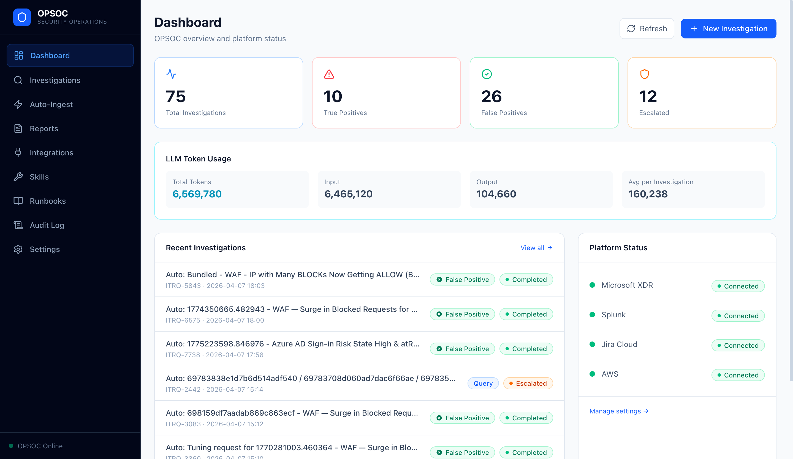

### Investigation List
Resizable columns, sortable by any column, filterable by status/verdict/source. Copy-on-click for IDs. Column visibility toggle.

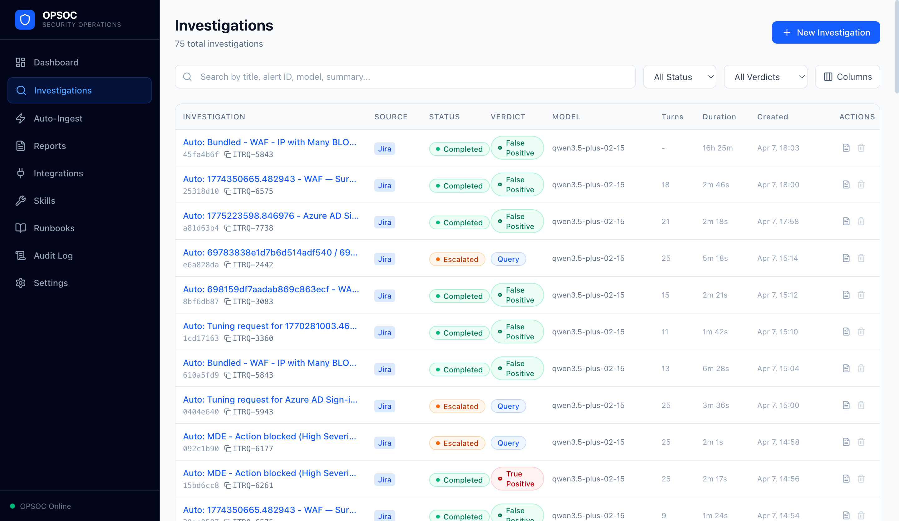

### Reports
Filterable by verdict, source, runbook, and date range. Clickable summary cards. Server-side pagination with global aggregates.

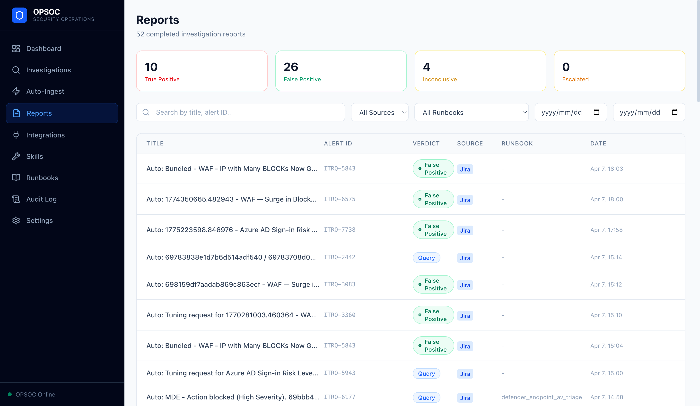

### Auto-Ingest
Automated polling from Jira MSSP cases and Defender alerts. Primary + fallback LLM configuration. Real-time cycle tracking with investigation results.

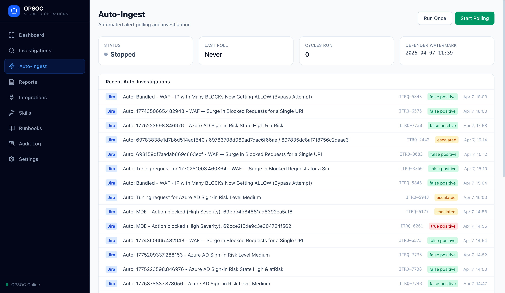

### Platform Integrations
5 platforms with one-click connectivity testing. All credentials masked — only ENV variable names stored in database.

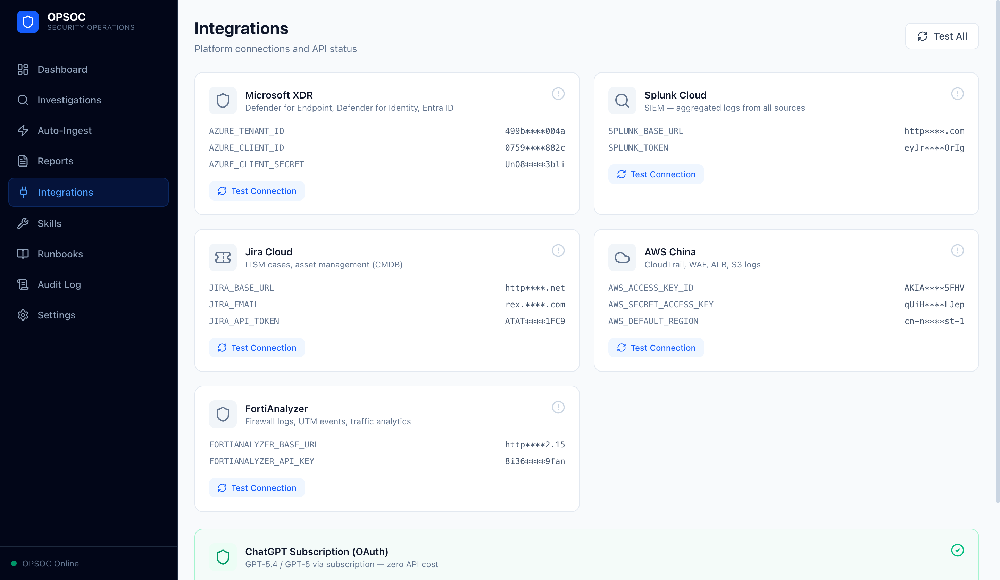

### Skills Registry
34 security tools across 5 platforms — atomic queries, pre-packaged investigation steps, and write operations (gated). Searchable by name and filterable by platform.

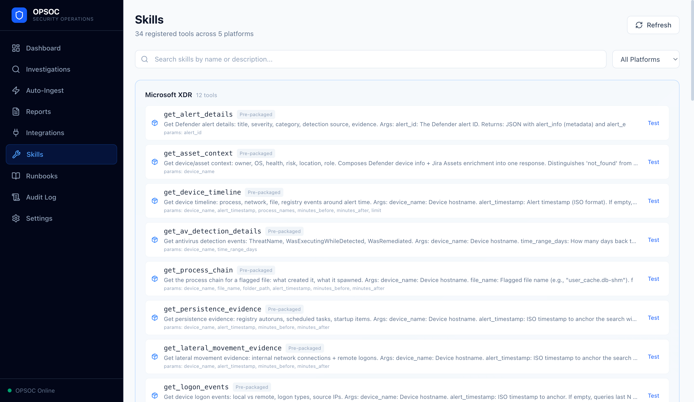

### Settings — LLM Providers
Multi-provider LLM system supporting 12 provider types including local models (Ollama, vLLM, LM Studio). Each provider independently configurable with contextual setup guidance.

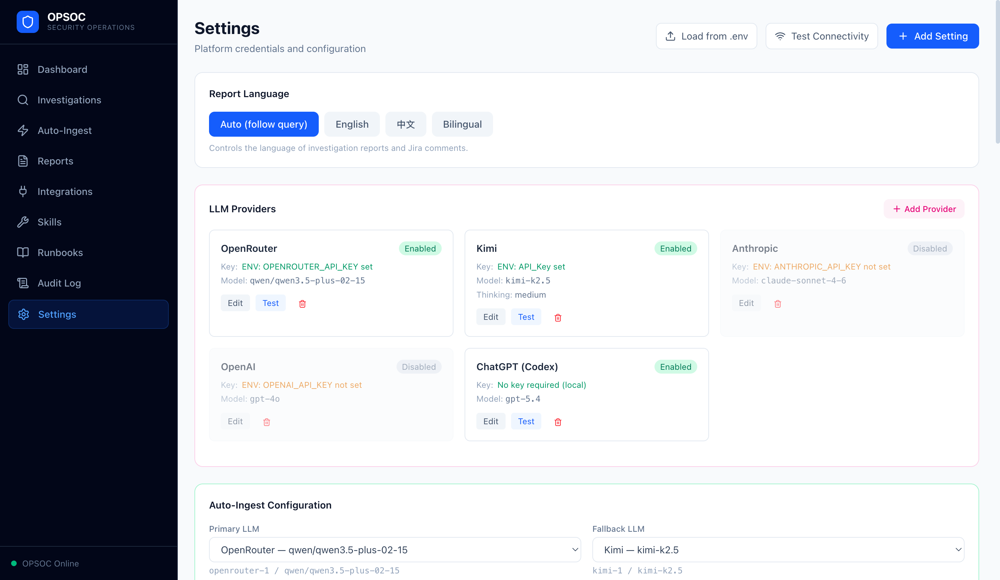

### Audit Log
Complete investigation audit trail with date range filtering and CSV export (up to 10,000 events). Every tool call, verdict decision, and status change recorded.

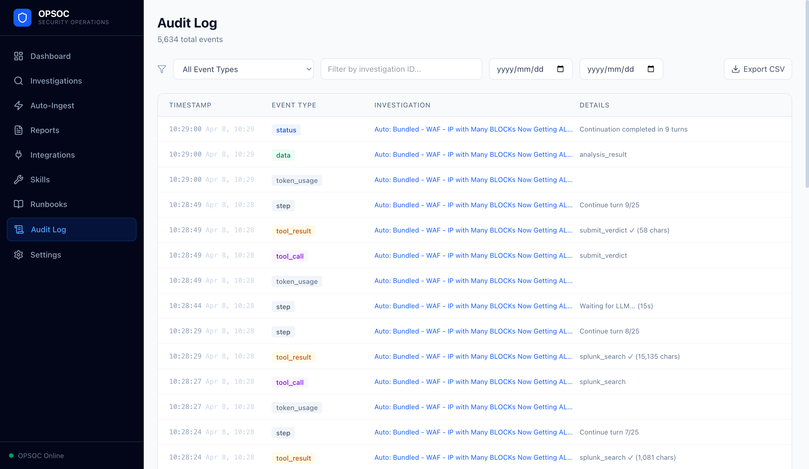

### Runbooks
Obligation-based investigation quality gates. Each runbook defines required evidence (skills that must be called) and required report fields. Currently active families cover Defender endpoint AV triage and MSSP case triage via Splunk.

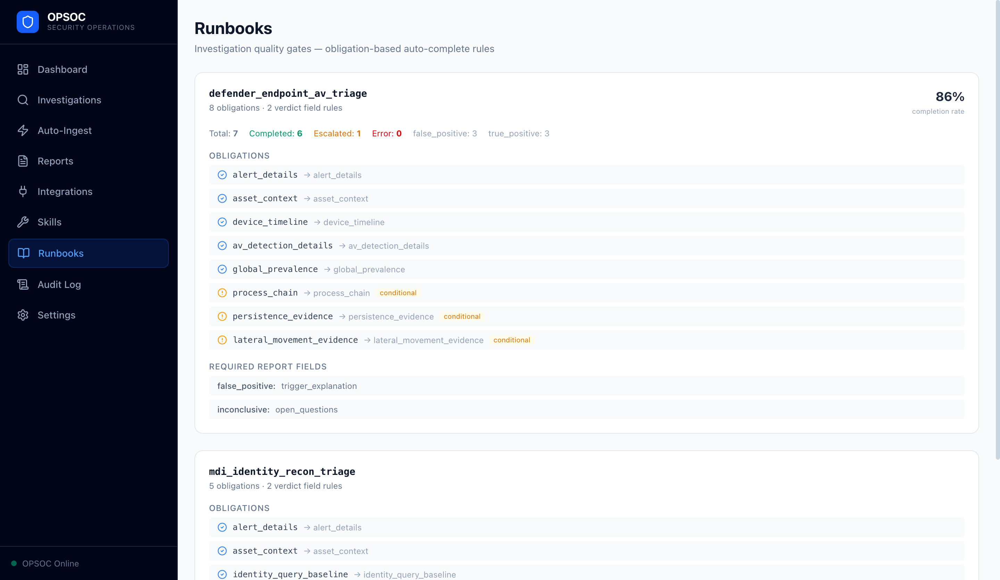

### Hunting
Proactive KQL threat hunting integrated into the auto-ingest cycle. 11 queries covering common APT TTPs — webshell creation, tunneling, lateral movement, credential access, and binary masquerading. Findings are deduped and the watermark advances fail-closed.

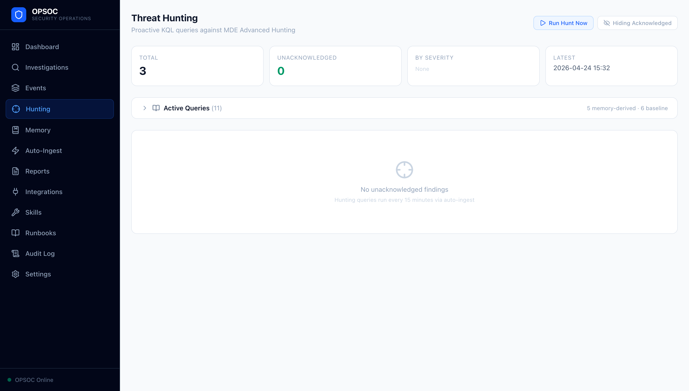

### Memory
Human-confirmed case memory with revision tracking. Each memory entry references a specific revision of the source investigation; mutating the verdict marks the memory stale. Multi-signal matching combining entity overlap, alert type, and title text means first-round investigations can pull historical context even before tool calls have populated entities.

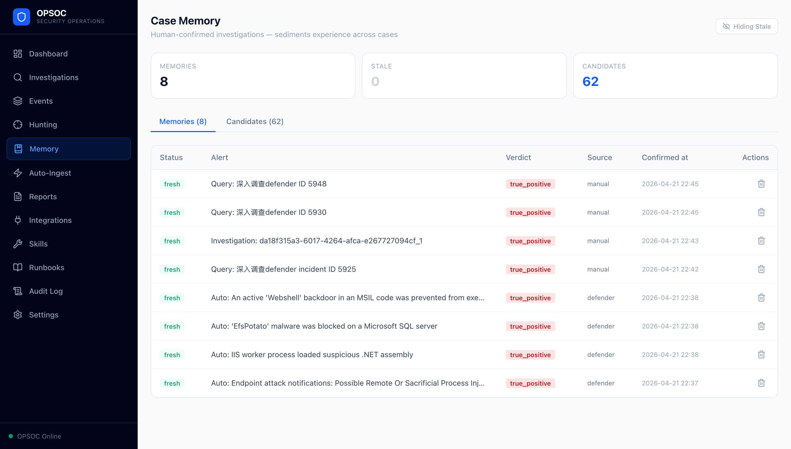

### Events
Investigations auto-correlate into Security Events when their extracted entities overlap. Derived status is computed from constituent investigation verdicts; the combined timeline merges all member investigations chronologically. Manual unlink supported.

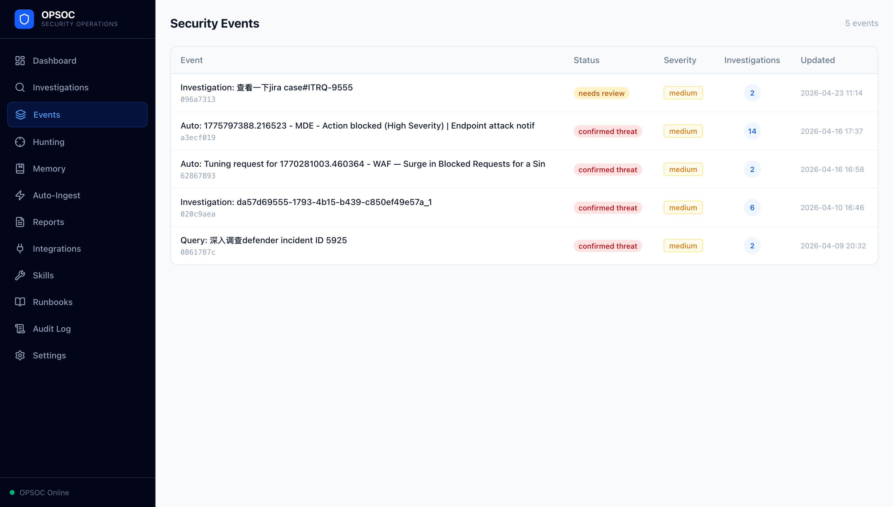

### Teams Notifications — Settings
TP investigations dispatch a Teams Adaptive Card to operator-managed recipients. Authentication secrets stay in `.env`; only the recipient list is editable from the UI. Direct message, group chat, and channel targets all supported.

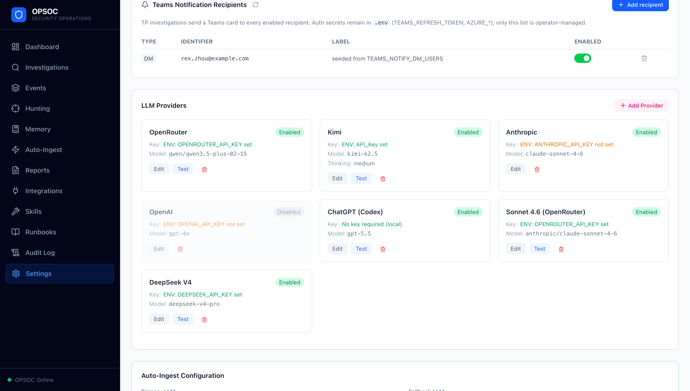

### Teams Notifications — Investigation Detail
Per-investigation notification panel renders only on `verdict='true_positive'`. Shows per-target status, expandable error details, and operator-driven retry controls.

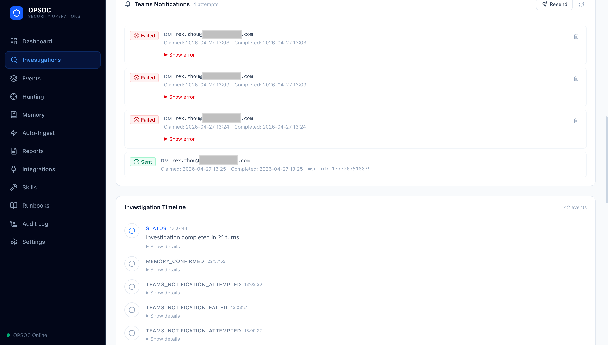

### Teams Notification — Live Adaptive Card
The Teams DM operators actually receive when an investigation reaches `true_positive`. Header combines verdict + execution status for at-a-glance urgency. Status FactSet shows execution / persistence / lateral movement at a glance. IOCs are typed (IP, payload pattern, target domain) with grounding markers. Numbered next-actions are operator-grade and case-specific.

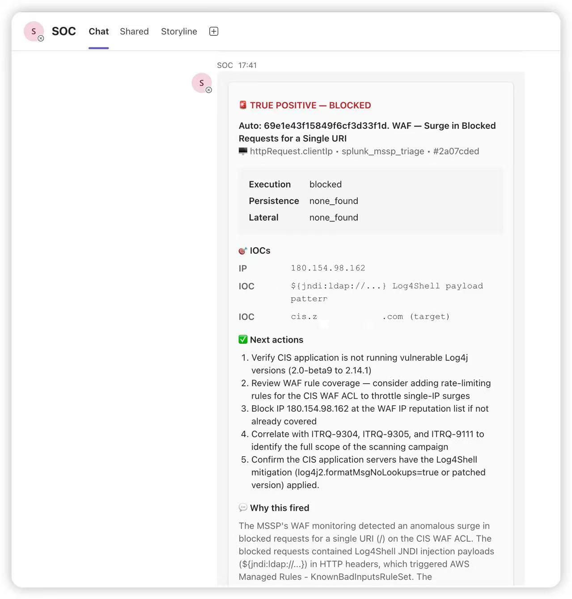

## Architecture

```
┌──────────────────────────────────────────────────────────────────────┐
│                         OPSOC Web UI (React, 15 pages)                │
│  Dashboard │ Investigations │ Reports │ Auto-Ingest │ Hunting │      │
│  Memory │ Events │ Settings (recipients + LLM) │ ...                  │
├──────────────────────────────────────────────────────────────────────┤
│                       FastAPI Backend + SQLite                        │
│  Investigation │ Audit │ LLM Providers │ Skills │ Notifications      │
│  Memory │ Events │ Hunting │ Replay Eval                              │
├──────────────────────────────────────────────────────────────────────┤
│              LangGraph Agent Loop (per investigation)                 │
│  ┌──────────┐  ┌──────────┐  ┌──────────────────────────┐            │
│  │ Routing  │→ │ Skill    │→ │ Verdict + Enforcer       │            │
│  │ + Packs  │  │ Execution│  │                          │            │
│  └──────────┘  └──────────┘  └──────────────────────────┘            │
│       │            │                                                  │
│       │            ↓                                                  │
│       │     ┌──────────────────┐    ┌────────────────────┐           │
│       │     │ Entity Extraction│ →  │ Case Memory        │           │
│       │     └──────────────────┘    └────────────────────┘           │
│       │                                       │                       │
│       ↓                                       ↓                       │
│  ┌────────────────────┐         ┌────────────────────────┐            │
│  │ Security Events    │ ←───── │ Investigation Report   │            │
│  └────────────────────┘         └────────────────────────┘            │
├──────────────────────────────────────────────────────────────────────┤
│            Auto-Ingest (15min cycle) + Proactive Hunting              │
│  Jira poll │ Defender poll │ KQL hunting queries                      │
├──────────────────────────────────────────────────────────────────────┤
│                       Multi-Provider LLM Layer                        │
│  OpenRouter │ Kimi │ Anthropic │ OpenAI │ ChatGPT Codex │ Ollama │   │
├──────────────────────────────────────────────────────────────────────┤
│                          Security Skills                              │
│  ┌───────────┐ ┌────────┐ ┌──────┐ ┌─────┐ ┌────────┐ ┌───────────┐ │
│  │ Microsoft │ │ Splunk │ │ Jira │ │ AWS │ │ Forti  │ │ Microsoft │ │
│  │ XDR/Entra │ │ Cloud  │ │Cloud │ │     │ │Analyzer│ │ Graph     │ │
│  │ + MDE LR  │ │        │ │ +CMDB│ │     │ │ (RPC)  │ │ (Teams)   │ │
│  └───────────┘ └────────┘ └──────┘ └─────┘ └────────┘ └───────────┘ │
└──────────────────────────────────────────────────────────────────────┘
```

## Core Design Principles

- **Fail-closed**: Every investigation path that can't reach a verdict escalates — never silently drops alerts
- **MSSP as untrusted input**: MSSP reports are raw data to verify, not ground truth
- **Audit trail is non-negotiable**: Every decision and action is logged
- **LLM-agnostic**: 12 provider types, switchable per investigation, including local models for sensitive environments
- **Security-first**: Read-only API access by default, credential isolation, content redaction pipeline

## Tech Stack

| Layer | Technology |
|-------|-----------|
| Agent Framework | LangGraph (Python) |
| Backend | FastAPI + SQLite (WAL mode), 16 tables |
| Frontend | React + TypeScript + Tailwind CSS, 15 pages |
| LLM | Multi-provider (OpenRouter, Kimi, Anthropic, OpenAI, ChatGPT Codex, Ollama, vLLM, ...) |
| Platforms | Microsoft Defender XDR, Splunk Cloud, Jira Cloud, AWS, FortiAnalyzer, Microsoft Graph (Teams) |
| Development | AI-assisted with peer-model code review |

## About the Author

**Rex Zhou** — CISSP, CCIE, 14 years in information security. Security Operations Manager building the next generation of AI-powered security operations.

- This project demonstrates that one security professional, armed with the right AI tools, can deliver SOC operations that exceed what a traditional MSSP team provides — with better accuracy, faster response, and at a fraction of the cost.
- Source code is private. This repository contains documentation and demo materials only.

---

<a name="中文"></a>

## 影响

| 改变前（MSSP） | 改变后（OPSOC） |
|----------------|----------------|
| 每年约 100 万元 MSSP 合同 | 每年约 10 万元（LLM API 成本） |
| 每个调查数小时（手动跨平台分流） | 每个调查 30-60 秒（自动化） |
| 65%+ 告警是误报，每个仍需人工审查 | 识别误报并附证据链，交由运营人员复核 |
| MSSP 分析师缺乏企业背景，产出通用报告 | 调查利用完整的企业上下文 — 资产归属、业务关键性、历史模式 |

## 问题

企业安全团队面临结构性困境：MSSP 价格昂贵但分析质量浅薄，因为外包分析师对你的组织没有任何上下文。他们不知道哪些服务器是关键的，哪些用户是高管，哪些"可疑"活动实际上是日常业务流程。结果就是告警疲劳 — 每月数百个案例，绝大部分是误报，但每一个仍需人工审查。

组建内部 SOC 团队解决了上下文问题，但成本高出 3-5 倍，对中型企业来说不现实。

## 核心洞察：为什么"一个人"很重要

OPSOC 背后的核心洞察是：**安全运营中最有价值的部分是隐性知识** — 那些存在于一个资深安全专家头脑中的组织理解：

- 哪些系统是业务关键的，哪些是开发沙箱
- 公司的技术栈、网络拓扑和正常流量模式
- 历史事件模式和已知的误报特征
- 监管合规背景（GxP 等行业特定合规要求）
- 与 IT、业务负责人和外部供应商的关系

这些知识无法转移给 MSSP。但它可以编码到 AI 系统的调查上下文中。**OPSOC 让一个人的专业能力可扩展** — 人提供判断力和上下文，AI 提供速度和广度。

## 解决方案

**OPSOC** 是一个生产级 AI SOC 平台，部署于一家上市生物制药公司：

1. **自动摄入** MSSP 的 Jira 升级案例和 Defender 告警
2. **跨平台关联** 5 个安全平台（XDR、SIEM、ITSM、Cloud、Firewall）
3. **产出** 带结构化判定的调查报告（True Positive / False Positive / Inconclusive）
4. **质量保障** 通过基于义务的 Runbook 强制执行调查质量
5. **审计记录** 以追加方式记录决策和操作，供合规与复核使用

运营人员审查 OPSOC 的判定，处理需要人工干预的真阳性事件，并持续改进系统的调查逻辑。

## 核心指标（生产数据，2026-04-27）

| 指标 | 数值 |
|------|------|
| 已完成调查 | 99+ |
| 误报识别率 | 65%+ |
| 平均调查时间 | 30-60 秒 |
| 成本降低 | 相比 MSSP 合同降低约 90% |
| 平台集成 | 5 个（XDR、SIEM、ITSM、Cloud、Firewall）+ Microsoft Graph（Teams 通知） |
| 支持 LLM 提供商 | 12 个（含本地模型） |
| Runbook（义务质量门）| 2 个活跃家族 |
| KQL Hunting 查询 | 11 个（每 15 分钟自动运行） |

## 实时调查演示

一个 Defender 告警调查 — 从自然语言查询到结构化判定 — 对接生产安全平台实时运行。

[](https://youtu.be/VuMIycNDEQY)

> **点击观看。** 分析师输入自由查询（FileZilla 捆绑软件检测），OPSOC AI Agent 自动调用 XDR、资产上下文、设备时间线、Jira 工单等多个 skill — 最终输出结构化 False Positive 判定及完整证据链。约 10 轮对话，约 120 秒，LLM API 成本不到 $0.02。

---

## 能力进展

原始路线图以事件响应作为生产基础，并规划了三个扩展阶段。目前 OPSOC 已在第二、
第三阶段交付有明确边界的能力，第四阶段也完成了第一次授权白盒评估：

- **第一阶段 — 事件响应（已运行）：** MSSP 案例分流、Defender 告警调查、跨平台取证、
  结构化判定、质量门控、案例记忆与可审计的人工复核。
- **第二阶段 — 检测工程（已实现 coverage 层）：** 定时 KQL hunting、发现去重、
  fail-closed watermark、面向 ATT&CK 的 hunting/coverage artifacts，以及将调查和评估证据
  转化为检测需求。OPSOC 不会自动将检测规则发布到生产环境。
- **第三阶段 — 漏洞管理（已实现 operator-led 优先级与验证流程）：** 解析 Tenable/Nessus
  数据，结合可利用性和业务上下文确定优先级，并提供按漏洞类型划分的验证 runbook。
  完整的 agent/enforcer 自动化与漏洞生命周期管理不属于当前能力声明。
- **第四阶段 — Red Team / 攻击性安全（首次评估完成，持续开发）：** 独立且受 scope
  门控的 pentest workflow 已支持一次企业级 agentic-AI 平台的授权白盒评估。测试仍由人主导，
  授权、高风险操作审批、影响判断和最终责任均由运营人员掌握。

统一原则没有变化：**AI 将安全专家的组织知识放大到多个领域**。同一个基于 skill 的核心
可以复用，但不会把 LLM 的解释当成授权、证据或专家判断的替代品。

## 第一次 AI 辅助白盒评估

OPSOC 最近支持完成了一次企业级 agentic-AI 平台的授权白盒评估测试阶段。评估在预生产
环境中进行，结合了架构与源码审查、受控行为测试和运行时验证。

这次实践验证的是一种可落地的 AI-powered pentest 模式：AI 帮助扩展假设、维护覆盖、
发现矛盾并整理证据；从 scope、测试用例、证据、finding、修正到 retest 的链路被完整保留。
模型、prompt、route 和可用工具集都属于被测系统的一部分，而模型自己的解释不构成证据。

授权、高风险操作审批、oracle 选择、影响判断和最终结论始终由人负责。这是 evidence-aware
co-testing workflow，不是自动利用产品，也不是“输入 prompt 就得到 pentest report”。

## 技术亮点

- **LangGraph Agent Loop**：每次调查运行独立的 agent loop，基于告警类型自动选择 skill pack
- **Fail-closed 设计**：所有无法得出结论的调查路径都会升级，绝不静默丢弃告警
- **多模型支持**：12 种 LLM provider，每次调查可独立选择模型，支持 Ollama/vLLM 本地部署
- **Runbook Enforcer**：基于义务的质量门控
- **完整审计链**：每个决策和操作都有记录

## 关于作者

**Rex Zhou** — CISSP, CCIE, 14 年信息安全经验。安全运营经理，致力于构建下一代 AI 驱动的安全运营。

- 本项目证明：一个安全专家配合正确的 AI 工具，能够交付超越传统 MSSP 团队的 SOC 运营 — 更高的准确率、更快的响应速度、不到十分之一的成本
- 源代码为私有仓库，本仓库仅包含文档和演示材料

---

*Built with AI-assisted development workflow*
